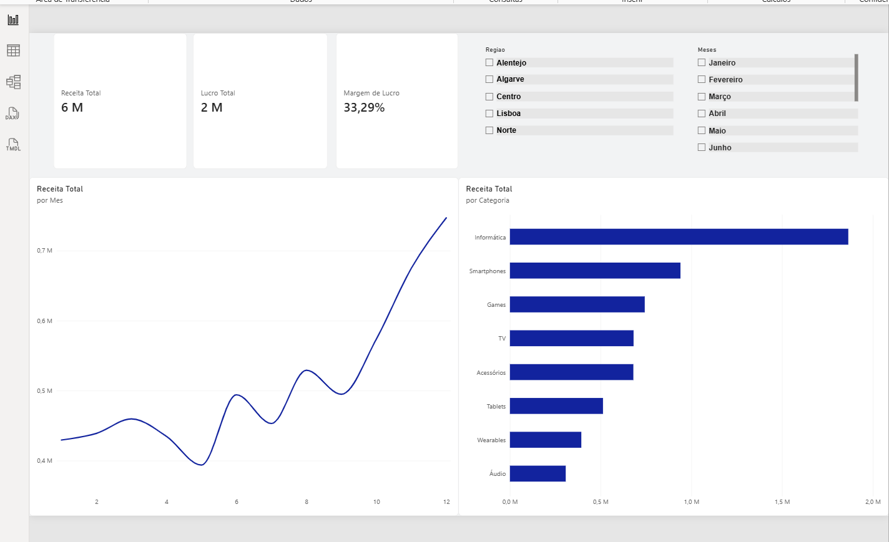

# NovaStore-Sales-Dashboard-Excel-Power-BI
# 📊 Projeto 1: NovaStore Sales Dashboard (Excel & Power BI)

---

## 📌 Visão Geral do Projeto
O *NovaStore Sales Dashboard* é uma solução completa de Business Intelligence criada para analisar o desempenho comercial, a rentabilidade por categoria e região, e o comportamento de vendas ao longo do tempo.

Este projeto simula um cenário real de e-commerce/retalho eletrónico, transformando dados brutos de transações numa ferramenta interativa para apoio à tomada de decisão executiva.

---

## 🎯 Objetivos de Negócio
* *Acompanhar KPIs Comerciais:* Avaliar a Receita Total, Margem de Lucro (%), Ticket Médio e Volume de Pedidos.
* *Análise Temporal:* Identificar a sazonalidade de vendas e meses com picos de faturamento.
* *Segmentação Regional e de Categoria:* Entender quais produtos e regiões geram maior rentabilidade.
* *Identificação de Clientes VIP:* Mapear os maiores compradores para estratégias de retenção.

---

## 🛠️ Arquitetura e Estrutura de Dados
O projeto foi modelado seguindo a arquitetura *Star Schema (Esquema em Estrela)* no Power BI, garantindo performance e integridade relacional:

* *Tabela Fato (fVendas):* Registo detalhado de todas as transações (Receita, Custo, Margem, Quantidade).
* *Tabelas Dimensão:*
  * dProdutos: Informações de produtos, categorias, preços e custos unitários.
  * dClientes: Registo de clientes, cidades e regiões.
  * dCalendario: Tabela temporal customizada para análises de inteligência temporal (YTD, MTD, sazonalidade).

---

## 📈 Principais Insights de Negócio
1. *Faturamento Geral:* A NovaStore atingiu uma Receita Total de *6.123.040 €, com um Lucro Total de **2.038.345 €* (Margem de *33,29%*).
2. *Sazonalidade:* O faturamento apresentou um crescimento contínuo no último trimestre do ano, atingindo o pico no mês de *dezembro* (*746.860 €*).
3. *Desempenho por Categoria:* A categoria de *Informática* lidera o volume de faturamento (*1.864.600 €), enquanto a categoria de **Acessórios* apresenta a maior margem de lucro percentual.
4. *Concentração Regional:* As regiões *Norte* e *Lisboa* concentram a grande maioria das vendas da empresa.

---

## 🖼️ Capturas do Dashboard Interativo

---
